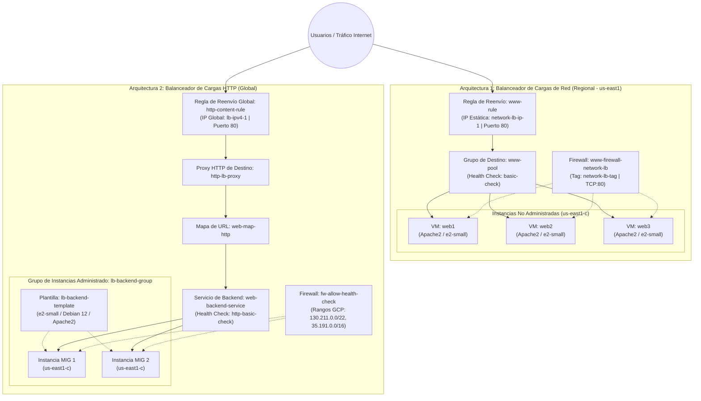

# Implementación de Balanceo de Cargas en Google Cloud Compute Engine

## 1. Introducción

El balanceo de cargas es un pilar fundamental en las arquitecturas modernas en la nube para garantizar la **alta disponibilidad**, la **tolerancia a fallos** y la **escalabilidad** de las aplicaciones web. En entornos de producción, depender de una única instancia de máquina virtual representa un punto único de fallo que puede comprometer la continuidad del servicio ante picos de tráfico o caídas de hardware.

Este documento detalla la automatización mediante scripts en **Bash** (utilizando la interfaz de línea de comandos `gcloud`) para desplegar dos soluciones complementarias de distribución de tráfico en **Google Cloud Platform (GCP)**:
1. **Balanceador de Cargas de Red (Network Load Balancer):** Opera en la capa de transporte (Capa 4 del modelo OSI) distribuyendo tráfico regional hacia un grupo de instancias independientes.
2. **Balanceador de Cargas HTTP (Application Load Balancer):** Opera en la capa de aplicación (Capa 7 del modelo OSI) enrutando tráfico global hacia un Grupo de Instancias Administrado (MIG) con capacidades de autorreparación.

---

## 2. Arquitectura Implementada

Al ejecutar los tres bloques de código, se construye una infraestructura dividida en dos flujos independientes dentro de la red VPC `default`:



---

## 3. Documentación y Código de Despliegue

### Bloque 1: Aprovisionamiento de Servidores Web y Firewall Base (`tarea1.sh`)

#### ¿Qué hace este bloque?
1. **Configuración del entorno:** Establece `us-east1` como región predeterminada y `us-east1-c` como zona de trabajo en `gcloud`.
2. **Limpieza preventiva:** Elimina instancias o reglas de firewall previas con los mismos nombres para garantizar una ejecución limpia e idempotente.
3. **Creación de instancias:** Mediante un bucle `for`, despliega tres máquinas virtuales (`web1`, `web2` y `web3`) con sistema operativo **Debian 12**, tipo de máquina `e2-small` y la etiqueta de red `network-lb-tag`. Cada instancia ejecuta un *startup-script* que instala **Apache2** y genera un archivo `index.html` personalizado con su propio nombre de host.
4. **Apertura de tráfico HTTP:** Crea la regla de firewall `www-firewall-network-lb` para permitir conexiones entrantes en el puerto `TCP:80` hacia cualquier instancia que posea la etiqueta `network-lb-tag`.
5. **Verificación:** Espera 30 segundos a que finalice la instalación de Apache y realiza peticiones `curl` a las IPs públicas de cada VM para validar que respondan correctamente.

#### Código
```bash
cat << 'EOF' > tarea1.sh
#!/bin/bash

# 1. Configurar región y zona predeterminadas
gcloud config set compute/region us-east1
gcloud config set compute/zone us-east1-c

# 2. Limpiar instancias o reglas de firewall previas (si existen)
gcloud compute instances delete web1 web2 web3 --zone=us-east1-c --quiet 2>/dev/null
gcloud compute firewall-rules delete www-firewall-network-lb --quiet 2>/dev/null

# 3. Crear las tres instancias de VM (web1, web2 y web3) en la red predeterminada
for i in 1 2 3; do
  gcloud compute instances create web$i \
    --zone=us-east1-c \
    --network=default \
    --machine-type=e2-small \
    --tags=network-lb-tag \
    --image-family=debian-12 \
    --image-project=debian-cloud \
    --metadata=startup-script="#!/bin/bash
apt-get update
apt-get install apache2 -y
service apache2 restart
echo '<h3>Web Server: web$i</h3>' | tee /var/www/html/index.html"
done

# 4. Crear la regla de firewall requerida para permitir tráfico HTTP
gcloud compute firewall-rules create www-firewall-network-lb \
    --network=default \
    --target-tags=network-lb-tag \
    --allow=tcp:80

# 5. Esperar 30 segundos a que finalice la instalación de Apache y comprobar con curl
echo "Esperando 30 segundos a que Apache inicie en las VMs..."
sleep 30

for IP in $(gcloud compute instances list --filter="name~'^web[1-3]$'" --format="value(networkInterfaces.accessConfigs.natIP)"); do
  echo "Probando http://$IP :"
  curl -s http://$IP
done
EOF

bash tarea1.sh
```

---

### Bloque 2: Configuración del Balanceador de Cargas de Red (`tarea2.sh`)

#### ¿Qué hace este bloque?
1. **Reserva de IP Estática Regional:** Crea la dirección IP externa `network-lb-ip-1` en la región `us-east1` para ofrecer un punto de entrada fijo a los clientes.
2. **Verificación de estado (Health Check):** Crea el recurso `basic-check` para monitorear periódicamente si los servidores responden por HTTP.
3. **Grupo de Destino (Target Pool):** Crea `www-pool` en `us-east1` asociando el chequeo de salud y registra dentro de él las tres máquinas virtuales (`web1`, `web2`, `web3`).
4. **Regla de Reenvío (Forwarding Rule):** Configura `www-rule` para capturar el tráfico entrante dirigido a la IP estática en el puerto `80` y distribuirlo entre las instancias del grupo de destino.
5. **Prueba de balanceo:** Extrae la IP del balanceador y ejecuta un ciclo de 5 peticiones `curl` para comprobar cómo las respuestas se alternan entre los tres servidores.

#### Código
```bash
cat << 'EOF' > tarea2.sh
#!/bin/bash

# 1. Crear una dirección IP externa estática para el balanceador de cargas
gcloud compute addresses create network-lb-ip-1 \
  --region=us-east1

# 2. Agregar un recurso de verificación de estado HTTP heredado
gcloud compute http-health-checks create basic-check

# 3. Agregar un grupo de destino (target pool) en la misma región que las instancias
gcloud compute target-pools create www-pool \
  --region=us-east1 \
  --http-health-check=basic-check

# 4. Agregar las tres instancias al grupo de destino
gcloud compute target-pools add-instances www-pool \
  --instances=web1,web2,web3 \
  --instances-zone=us-east1-c

# 5. Agregar una regla de reenvío (forwarding rule) en el puerto 80
gcloud compute forwarding-rules create www-rule \
  --region=us-east1 \
  --ports=80 \
  --address=network-lb-ip-1 \
  --target-pool=www-pool

# 6. Obtener la IP asignada y probar que el tráfico se dispersa entre las VMs
IPADDRESS=$(gcloud compute forwarding-rules describe www-rule --region=us-east1 --format="json" | jq -r .IPAddress)
echo "IP del Balanceador de Cargas de Red: $IPADDRESS"

echo "Probando distribución de tráfico (5 peticiones)..."
for i in {1..5}; do
  curl -m1 -s http://$IPADDRESS
done
EOF

bash tarea2.sh
```

---

### Bloque 3: Configuración del Balanceador de Cargas HTTP Global (`tarea3.sh`)

#### ¿Qué hace este bloque?
1. **Plantilla de Instancias:** Define `lb-backend-template` con las especificaciones base (Debian 12, `e2-small`, etiqueta `allow-health-check`) y un script de inicio que muestra el nombre dinámico de cada VM obteniéndolo desde el servidor de metadatos interno de GCP (`169.254.169.254`).
2. **Grupo de Instancias Administrado (MIG):** Despliega `lb-backend-group` con un tamaño fijo de 2 instancias en `us-east1-c` basadas en la plantilla anterior.
3. **Firewall para Sondas de Salud:** Crea `fw-allow-health-check` permitiendo tráfico `TCP:80` exclusivamente desde los rangos IP oficiales de los verificadores de estado de Google Cloud (`130.211.0.0/22` y `35.191.0.0/16`).
4. **Componentes Globales de Capa 7:**
   * Reserva la IP global `lb-ipv4-1`.
   * Crea el chequeo de salud `http-basic-check` y el servicio de backend `web-backend-service` vinculado al grupo administrado.
   * Configura el mapa de URL (`web-map-http`), el proxy HTTP de destino (`http-lb-proxy`) y la regla de reenvío global (`http-content-rule`) en el puerto `80`.

#### Código
```bash
cat << 'EOF' > tarea3.sh
#!/bin/bash

# 1. Crear la plantilla de instancias (lb-backend-template)
gcloud compute instance-templates create lb-backend-template \
   --region=us-east1 \
   --network=default \
   --subnet=default \
   --tags=allow-health-check \
   --machine-type=e2-small \
   --image-family=debian-12 \
   --image-project=debian-cloud \
   --metadata=startup-script='#!/bin/bash
     apt-get update
     apt-get install apache2 -y
     a2ensite default-ssl
     a2enmod ssl
     vm_hostname="$(curl -H "Metadata-Flavor:Google" \
     http://169.254.169.254/computeMetadata/v1/instance/name)"
     echo "Page served from: $vm_hostname" | \
     tee /var/www/html/index.html
     systemctl restart apache2'

# 2. Crear el grupo de instancias administrado (lb-backend-group)
gcloud compute instance-groups managed create lb-backend-group \
   --template=lb-backend-template \
   --size=2 \
   --zone=us-east1-c

# 3. Crear la regla de firewall para las verificaciones de estado (fw-allow-health-check)
gcloud compute firewall-rules create fw-allow-health-check \
  --network=default \
  --action=allow \
  --direction=ingress \
  --source-ranges=130.211.0.0/22,35.191.0.0/16 \
  --target-tags=allow-health-check \
  --rules=tcp:80

# 4. Reservar una dirección IPv4 externa estática global (lb-ipv4-1)
gcloud compute addresses create lb-ipv4-1 \
  --ip-version=IPV4 \
  --global

# 5. Crear la verificación de estado HTTP (http-basic-check)
gcloud compute health-checks create http http-basic-check \
  --port=80

# 6. Crear el servicio de backend y asociar el grupo de instancias administrado
gcloud compute backend-services create web-backend-service \
  --protocol=HTTP \
  --port-name=http \
  --health-checks=http-basic-check \
  --global

gcloud compute backend-services add-backend web-backend-service \
  --instance-group=lb-backend-group \
  --instance-group-zone=us-east1-c \
  --global

# 7. Crear el mapa de URL (web-map-http)
gcloud compute url-maps create web-map-http \
    --default-service=web-backend-service

# 8. Crear el proxy HTTP de destino (http-lb-proxy)
gcloud compute target-http-proxies create http-lb-proxy \
    --url-map=web-map-http

# 9. Crear la regla de reenvío global (http-content-rule) en el puerto 80
gcloud compute forwarding-rules create http-content-rule \
   --address=lb-ipv4-1 \
   --global \
   --target-http-proxy=http-lb-proxy \
   --ports=80

# 10. Mostrar la IP global del balanceador HTTP
LB_IP=$(gcloud compute addresses describe lb-ipv4-1 --format="get(address)" --global)
echo "========================================================="
echo "Balanceador de cargas HTTP creado en la IP: http://$LB_IP"
echo "Espera ~1 minuto a que los backends estén saludables."
echo "========================================================="
EOF

bash tarea3.sh
```

---

## 4. Conclusiones

* **Diferencia entre arquitecturas:** Mientras que el **Balanceador de Cargas de Red** reenvía paquetes TCP/UDP directamente a nivel regional sobre instancias individuales, el **Balanceador de Cargas HTTP** proporciona una dirección IP Anycast global, enrutamiento inteligente basado en URL y se integra de forma nativa con Grupos de Instancias Administrados (MIG).
* **Automatización e Infraestructura como Código:** El uso de scripts en Bash con `gcloud` elimina errores manuales en la consola web, reduce los tiempos de despliegue de minutos a segundos y garantiza que los nombres, etiquetas (*tags*) y rangos de red cumplan estrictamente con los requisitos técnicos.
* **Seguridad perimetral granular:** El uso de etiquetas de red (`network-lb-tag` y `allow-health-check`) permite aplicar reglas de firewall específicas únicamente a las instancias que las necesitan, evitando exponer puertos innecesarios a toda la red VPC.

---

## 5. Recomendaciones

1. **Habilitar el Autoescalado (Autoscaling):** En entornos productivos sobre el Grupo de Instancias Administrado (`lb-backend-group`), se recomienda configurar políticas de autoescalado basadas en el uso de CPU o utilización de balanceo HTTP para que Google Cloud añada o elimine VMs automáticamente según la demanda real.
2. **Implementar HTTPS con Certificados Gestionados:** Para tráfico en producción, sustituye el proxy HTTP (`target-http-proxies`) por un proxy HTTPS (`target-https-proxies`) junto con un certificado SSL administrado por Google para cifrar la comunicación extremo a extremo.
3. **Eliminar IPs públicas individuales en el backend:** En la Tarea 3, las instancias del grupo administrado (`lb-backend-group`) no necesitan direcciones IP externas públicas para recibir tráfico del balanceador HTTP; desactivarlas y usar **Cloud NAT** para las actualizaciones de paquetes (`apt-get`) reduce significativamente la superficie de ataque.
4. **Migrar hacia Infraestructura Declarativa:** Para proyectos de mayor escala, se sugiere trasladar estos comandos imperativos de Bash a herramientas declarativas como **Terraform**, lo que facilita el control de versiones y la gestión del estado de la infraestructura.
